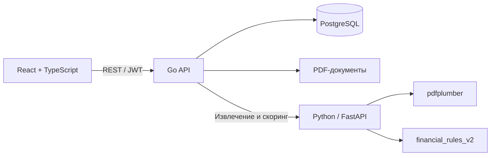

# AlphaHub

**Кредитный кабинет малого бизнеса: от финансового PDF до объяснимого решения.**

Клиент выбирает условия кредита, загружает финансовую сводку и подтверждает извлечённые показатели. AlphaHub
рассчитывает скоринг и направляет заявку по одному из трёх маршрутов: предложение, ручное рассмотрение или отказ.
Сотрудник банка работает с документами, показателями и историей в одной карточке.

[Проверить демо](#демонстрация) · [Запустить проект](#быстрый-запуск)
## Зачем это банку и бизнесу

При рассмотрении заявки финансовые документы нужно перенести в таблицу, проверить и сопоставить с условиями кредита.
Если данных недостаточно, клиенту приходится возвращаться к заявке, а сотруднику — восстанавливать контекст переписки.

AlphaHub собирает этот процесс в одном кабинете. Клиент проверяет уже извлечённые данные вместо заполнения таблицы с
нуля. Банк получает подтверждённые показатели, объяснение балла и историю действий. Типовые заявки проходят по правилам;
пограничные остаются у сотрудника.

Пользу решения можно проверить на конкретной заявке: исходный PDF, вход скоринга, его результат и принятое решение
сохраняются отдельно. Скорость обработки, снижение затрат и качество оценки реального кредитного риска на банковских
данных пока не измерялись.

## Что работает в MVP

| Клиент                                                  | Сотрудник банка                                       |
| ------------------------------------------------------- | ----------------------------------------------------- |
| Регистрация, вход и профиль компании                    | Очередь заявок, фильтры и поиск                       |
| Выбор продукта и сохранение черновика                   | Карточка компании, PDF и финансовые данные            |
| Загрузка PDF, исправление и подтверждение показателей   | Скоринг с положительными и отрицательными факторами   |
| Подача заявки и просмотр её истории                     | Взятие заявки в работу и передача исполнителю         |
| Ответ на запрос дополнительных данных                   | Запрос пояснений или дополнительных документов        |
| Принятие предложения или отказ с причиной               | Одобрение, отказ или встречные условия                |

Доступ к чужим заявкам проверяется сервером. Версия данных защищает от перезаписи устаревшей формы. Ошибка извлечения
или недоступность DS не превращаются в кредитный отказ.

## Демонстрация

Начните с одного из четырёх сценариев. Условия и ожидаемые результаты зафиксированы
в [manifest.json](ds/demo_pdfs/manifest.json); их проверяет тест через настоящий FastAPI и извлечение PDF.

| Документ                                      | Продукт            | Сумма / срок        | Ставка   | Балл   | Результат             |
| --------------------------------------------- | ------------------ | ------------------- | -------: | -----: | --------------------- |
| [stable.pdf](ds/demo_pdfs/stable.pdf)         | Оборотный кредит   | 2 млн ₽ / 12 мес.   | 19,9%    | 83     | Предложение           |
| [medium.pdf](ds/demo_pdfs/medium.pdf)         | Оборотный кредит   | 1 млн ₽ / 18 мес.   | 19,9%    | 57     | Ручное рассмотрение   |
| [risky.pdf](ds/demo_pdfs/risky.pdf)           | Оборотный кредит   | 5 млн ₽ / 12 мес.   | 19,9%    | 16     | Отказ                 |
| [equipment.pdf](ds/demo_pdfs/equipment.pdf)   | На оборудование    | 2 млн ₽ / 24 мес.   | 18%      | 91     | Предложение           |

Все документы синтетические. Они содержат **апрель–сентябрь 2026** и подходят для первой подачи в **октябре 2026**. Балл
относится к сочетанию финансов и условий заявки, а не к имени PDF. Для другого месяца нужен соответствующий финансовый
период.

Демонстрационный пароль всех аккаунтов: **`AlphaHubTest2026!`**.

| Аккаунт            | Назначение                                |
| ------------------ | ----------------------------------------- |
| `client@demo.ru`   | Компания для stable.pdf и equipment.pdf   |
| `medium@demo.ru`   | Компания для medium.pdf                   |
| `risky@demo.ru`    | Компания для risky.pdf                    |
| `bank@demo.ru`     | Сотрудник банка                           |

### Показ за несколько минут

1. Войдите как `client@demo.ru`. Выберите оборотный кредит, **2 млн ₽ на 12 месяцев**, загрузите stable.pdf и
   подтвердите шесть строк финансов. Подайте заявку: **83 балла, предложение**. Примите его — сервер сохранит
   `ACCEPTED`.
2. В отдельном сеансе войдите как `medium@demo.ru`: **1 млн ₽ на 18 месяцев**, medium.pdf. Получится **57 баллов
   и `MANUAL`**.
3. Откройте кабинет `bank@demo.ru`, возьмите эту заявку в работу. Покажите PDF, причины оценки и историю; запросите
   пояснения либо предложите другие условия.
4. Для автоматического отказа используйте risky.pdf и **5 млн ₽ на 12 месяцев**. Для второго продукта — equipment.pdf и
   **2 млн ₽ на 24 месяца**.

Подробные шаги, ИНН и ответы API — в [сценариях приёмки](docs/TEST_SCENARIOS.md)
и [описании демо-набора](docs/DEMO_DATA.md). Схема выше объясняет процесс; она не является скриншотом интерфейса.

## Архитектура и технологии



- **Frontend:** React 19, TypeScript, Vite, React Router; кабинеты клиента и сотрудника.
- **Backend:** Go, PostgreSQL, JWT; документы, версии данных, решения, предложения и история.
- **DS:** Python, FastAPI, Pydantic, pdfplumber; валидация, извлечение и формульный скоринг.
- **Запуск:** Docker Compose, nginx, автоматическое применение миграций, отдельные volumes для БД и PDF.

DS вычисляет оценку; окончательный маршрут определяет
Go. [Архитектура](docs/ARCHITECTURE.md) · [Модель данных](docs/DATA_MODEL.md) · [Состояния заявки](docs/APPLICATION_STATES.md).

## Скоринг и работа с PDF

Из текстовой финансовой сводки извлекаются ИНН, шесть месяцев выручки, операционных поступлений, выплат и налогов, а
также текущий кредитный платёж. Клиент видит таблицу и подтверждает её перед подачей. Сумма, срок и ставка нового
кредита берутся из заявки.

`financial_rules_v2` оценивает три составляющие:

| Показатель             | Что оцениваем                                               | Максимум   |
| ---------------------- | ----------------------------------------------------------- | ---------: |
| Покрытие платежей      | Хватает ли денежного потока на действующий и новый кредит   | 60         |
| Стабильность выручки   | Насколько сильно менялась выручка                           | 20         |
| Динамика выручки       | Последние три месяца относительно первых трёх               | 20         |

Между опорными точками баллы меняются плавно. При недостаточном покрытии итог ограничивается 39. Пороги Go: **0–39 —
отказ, 40–69 — сотрудник, 70–100 — предложение после проверки данных и лимитов продукта**. Балл не является вероятностью
дефолта.

Оба продукта используют одну формулу. Они отличаются назначением, лимитами и ставкой. Правила, формулы и ограничения
описаны в [спецификации скоринга](ds/SCORING_SPEC.md).

## Быстрый запуск

Нужны Git, Docker Engine / Docker Desktop с Linux containers и Docker Compose v2. На Windows — WSL2. Первый запуск
требует интернета и свободных портов 5173, 8080, 8001 и 5433.

```bash
git clone https://github.com/qu0ta/AlphaHub.git
cd AlphaHub
docker compose up --build -d
docker compose ps -a
```

Откройте **http://localhost:5173** и войдите одним из аккаунтов выше. `migrate` должен завершиться с кодом **0**,
остальные сервисы — перейти в `healthy`.

| Сервис                      | Адрес                                   |
| --------------------------- | --------------------------------------- |
| Кабинеты                    | http://localhost:5173                   |
| Go API: каталог продуктов   | http://localhost:8080/api/v1/products   |
| DS Swagger                  | http://localhost:8001/docs              |
| PostgreSQL                  | localhost:5433                          |

Файл `.env` необязателен: стандартные настройки уже заданы в Compose. Если порты заняты,
скопируйте [.env.example](.env.example) в `.env` и измените их. Все публичные порты привязаны к localhost;
демонстрационные секреты не подходят для публикации в интернете.

```bash
docker compose logs --tail=100 backend ds migrate
docker compose down
```

Обычный `down` сохраняет БД и документы. Сиды не перезаписывают существующих пользователей: если демо-аккаунт уже был в
базе, у него сохранится прежний пароль. Не удаляйте volumes ради обновления проекта.

## Проверки

Из корня проекта, в Python-окружении с `ds/requirements-dev.txt`:

```bash
cd ds
python demo.py --check
python -m unittest test_api test_metrics test_schema_contract test_financials_api test_pdf_validation test_product_conditions test_scoring test_score_result test_risk_flags test_demo_scenarios test_flexible_pdf_parser
python test_pdf_parser.py
python test_pdf_generator.py
python test_profiles.py
cd ..
```

`--check` проверяет SHA-256 PDF, исходные показатели и ожидаемые баллы из manifest. Пересоздание документов —
`python demo.py --write`; правила и исходные финансовые fixtures при этом сохраняются.

Полный сценарий через nginx → Go → DS → PostgreSQL создаёт новые заявки. Запускайте его на отдельной демонстрационной
базе:

```bash
python scripts/smoke_demo.py --base-url http://localhost:5173
```

Go: `go test ./... -count=1` из backend; для DB-тестов нужен `TEST_DATABASE_URL` тестовой базы. Фронт: `npm ci`,
`npm test`, `npm run typecheck`, `npm run build` из frontend.

## Исследование Rules vs ML

Отдельный модуль сравнивает финансовые правила и Logistic Regression на **54 000 синтетических заявок**: три seed,
базовый сценарий, повышенный шум и стресс. Обучение идёт только на train, порог выбирается на validation, качество
проверяется на независимых данных.

ML лучше ранжирует риск по ROC-AUC, но не даёт устойчивого снижения условной стоимости ошибок во всех сценариях. Цена
ошибок учитывает потерю по одобренному дефолту и упущенную прибыль по отклонённому надёжному клиенту. Вывод относится к
синтетике, а не к эффективности реального банка.

**Обученная модель не участвует в решениях MVP.** [Методика](docs/ds/SCORING_BENCHMARK.md) · [Результаты и допущения](docs/ds/SCORING_BENCHMARK_RESULTS.md) · [Воспроизведение](ds/experiments/README.md).

## Границы MVP

- Базовый контейнер обрабатывает текстовые PDF согласованной формы. OCR сканов и Docling для иной структуры не входят в
  стандартную поставку; отсутствующие показатели не дополняются вымышленными значениями.
- ЕГРЮЛ, ФНС и БКИ не подключены. Реестр компаний локальный; внешние проверки в интерфейсе — демонстрационные.
- Реальный серверный процесс заканчивается на принятии или отклонении предложения. Подписание и выдача, которые
  интерфейс может показывать далее, симулируются.
- Скоринг не обучен и не откалиброван на реальных погашениях. Готовность к промышленной эксплуатации не заявляется.

## Документация и команда

[API-контракты](docs/API_CONTRACTS.md) · [Go OpenAPI](docs/openapi/go.json) · [Сторонние компоненты и лицензии](THIRD_PARTY_NOTICES.md).

AlphaHub разработан командой хакатона. Авторство и вклад участников доступны
в [истории проекта](https://github.com/qu0ta/AlphaHub/graphs/contributors).

Материалы для проверки и порядок демонстрации собраны в [SUBMISSION.md](SUBMISSION.md).
