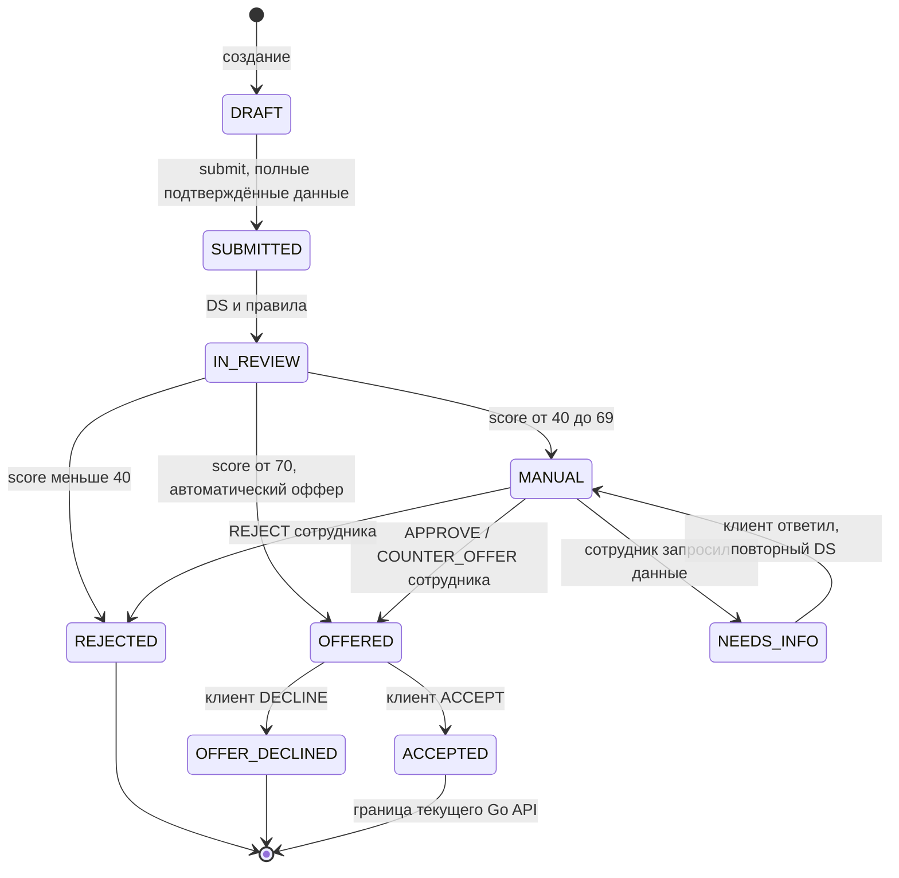
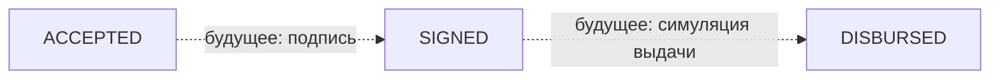

# Состояния заявки

Диаграмма ниже соответствует `internal/application/repository.go`, `decision.go` и `internal/bank/repository.go`. Статусы английские — реальные значения API.

SUBMITTED и IN_REVIEW фиксируются в истории одной транзакции; внешний ответ submit уже содержит итоговый статус. Невалидные данные, неподтверждённые финансы или ошибка DS не являются переходом REJECTED: запрос завершается ошибкой, транзакция откатывается. История хранит порядок переходов и автора.

Для решения сотруднику нужно взять MANUAL-заявку в работу. Запрос данных переводит её в NEEDS_INFO; после ответа используется прежняя дата подачи и ставка, выполняется повторный скоринг и возврат на ручную проверку. Финансовые данные при изменении заново подтверждаются. Высокий балл после ответа не обходит ручное решение.

Истёкший PENDING-оффер показывается как EXPIRED; принять его нельзя (409). Истечение само по себе не запускает отдельную задачу изменения статуса applications. Поэтому OFFER_EXPIRED не показан как самостоятельный автоматический переход.

## Целевой этап, ещё без Go-ручек

Колонки signed_at/disbursed_at и значения в фильтрах не означают реализацию этого сценария. После DECLINE сервер сейчас сохраняет OFFER_DECLINED; автоматический «улучшенный оффер при наличии запаса» также требует отдельной реализации. Эти возможности нельзя включать в список пройденных серверных сценариев.
