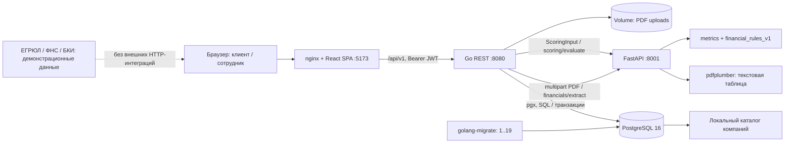

# Архитектура

Старт: healthy PostgreSQL → успешный migrate; healthy DS + migrate → Go; healthy Go → nginx.
Для браузера используется один origin, поэтому CORS не нужен. DS вызывается сервером Go, а не браузером. Порты хоста ограничены loopback в Compose.

Go разделён на `auth`, `product`, `company`, `application`, `documents`, `financials`, `bank`, `dsclient`. Внутри модулей — handler/service/repository. В PostgreSQL сохраняются версии данных, подтверждения, вход/выход скоринга, решения, офферы и история статусов; PDF сохраняется отдельно, в БД — метаданные и storage_key.

DS не принимает кредитное решение: вычисляет балл и объяснение. Go применяет пороги 40/70. HTTP 422 означает невозможность расчёта/невалидный ввод, 5xx — техническую ошибку. Эти случаи не подменяются score=0 или отказом клиенту. При ошибке DS транзакция подачи откатывается.

Дата DS `application_date` берётся из первоначального `submitted_at`, ставка — из сохранённых условий заявки. Вход скоринга сохраняется как `features_snapshot`; данные финансов и скоринга привязаны к `data_version`. При правках нужно повторное подтверждение; устаревшая версия возвращает 409.

В текущей реализации обращение к DS происходит внутри транзакции подачи. Это упрощает согласованность демонстрации, но удерживает блокировку во время HTTP-вызова. Фоновая очередь и outbox не реализованы. ЕГРЮЛ/БКИ/ФНС — моделируемые интеграции, их нельзя представлять как запросы к реальным реестрам.
