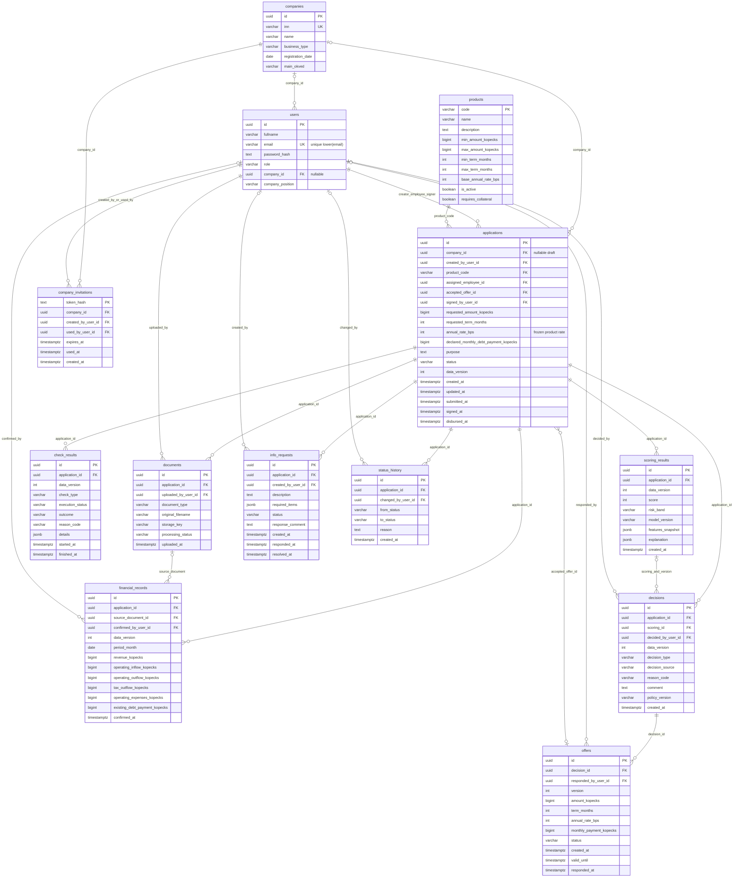

# Модель данных PostgreSQL

Источник — `backend/migrations/000001..000019`. Схема показывает таблицы предметной области; служебная `schema_migrations(version, dirty)` управляется golang-migrate.

Основные ограничения: INN 10/12 цифр; суммы неотрицательные/положительные по смыслу; срок положительный; балл 0..100; финансовый месяц — первое число. Финансовая строка уникальна по `(application_id,data_version,period_month)`.
Составные FK связывают `(source_document_id,application_id)` с документом именно этой заявки и `(scoring_id,application_id,data_version)` с соответствующим скорингом. Accepted offer ссылается на offers; принадлежность оффера заявке дополнительно проверяет Go в транзакции.

Миграция 14 допускает незаполненный DRAFT, 16 добавляет долг, 17 — демо-компании/продукт, 18 — requires_collateral, сохранённую ставку заявки и equipment_loan, 19 — демо-аккаунты. `company_invitations` существует в БД, но маршруты приглашений не подключены в текущем main.go.
